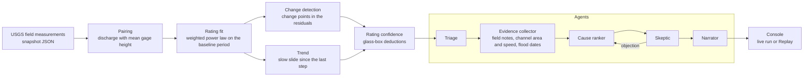

# DriftWatch

Every published streamflow number is computed. A gauge records the water level (stage), and a rating curve converts that stage to discharge. Hydrographers check the curve by measuring discharge directly on field visits. When the channel changes, the field measurements move away from the curve, and the published flows stay wrong until someone redraws it. DriftWatch reads the USGS field measurements for a gauge, fits the rating it was using, and tests whether the newest measurements have moved off it: as a step (a change point in the residuals) or as a slow slide (a trend). It then gives the gauge a rating confidence from 0 to 100 <!-- src: docs/plan.md --> with every deduction printed.

When a gauge has moved, a team of agents explains why. They collect the field notes and channel measurements, rank the likely causes (scour, fill, debris, vegetation, datum change), and a Skeptic checks the ranking against the evidence before a narrator writes a short finding for a utility manager. You can watch the agents work in the console, or replay a saved run. The first module covers 8 USGS gauges <!-- src: CLAUDE.md --> in western North Carolina and East Tennessee after Hurricane Helene, plus the Eno River at Hillsborough, NC (USGS 02085000 <!-- src: CLAUDE.md -->) as a control.

**Live console:** https://driftwatch-144765976306.us-east1.run.app <!-- src: docs/deploy_status.md -->
The service runs on Google Cloud Run in snapshot mode. A first request after an idle period waits [cold-start time, s] for the container to start.

## Set up from a clean clone

You need Python 3.11 or newer <!-- src: pyproject.toml --> and `make`. These steps were run in a fresh virtual environment on thoth, an Orange Pi (aarch64 <!-- src: docs/eval_report.md -->, Python 3.13 <!-- src: docs/plan.md -->), on 2026-11-07 <!-- src: docs/pi_docs_status.md --> from a clone of this branch.

```sh
git clone https://github.com/inmang13/driftwatch.git
cd driftwatch
python3 -m venv .venv
.venv/bin/python -m pip install --upgrade pip
.venv/bin/python -m pip install -e ".[dev,agents,api]" httpx
make test
make demo
make serve        # console at http://localhost:8000/
```

On Windows, use `.venv\Scripts\python.exe` in place of `.venv/bin/python`. `make install` runs the same `pip install` for you.

Install all three extras. Without `agents` and `api`, `tests/test_agents.py` and `tests/test_api.py` fail to import (no langgraph, no fastapi). `httpx` is already a core dependency; listing it does no harm.

What the clean run gave on thoth:

| Step | Result | Time |
|---|---|---|
| `pip install -e ".[dev,agents,api]" httpx` | installed, exit 0 | about 5 min <!-- src: docs/pi_docs_status.md --> |
| `make test` | 159 passed <!-- src: docs/pi_docs_status.md --> | 7 min 7 s <!-- src: docs/pi_docs_status.md --> |
| `make demo` | green offline: Hepco Stale 24, Swannanoa Trusted 94 <!-- src: docs/pi_docs_status.md --> | 56 s <!-- src: docs/pi_docs_status.md --> |
| `make serve` | console at `/` returned 200 and `/gauges` listed 8 gauges <!-- src: docs/pi_docs_status.md --> | ready in 9 s <!-- src: docs/pi_docs_status.md --> |

`make test` and `make demo` never call an LLM. Both run offline with `LLM=fallback`. To run the agents on live models, copy `.env.example` to `.env`, fill in `GOOGLE_CLOUD_PROJECT`, `GOOGLE_APPLICATION_CREDENTIALS` and `OPENROUTER_API_KEY`, and run `make run SITE=03455000 LLM=gemini`.

Other commands: `make report SITE=<site>` (engine only, writes `reports/<site>.json`), `make evals` (writes `docs/eval_report.md`), `make snapshot SOURCE=live` (refetches USGS; only on purpose).

## Pipeline



Each agent node emits events to the console over server-sent events, and every run writes a trace to `traces/` that the console can replay.

## How the engine works

1. **Pairing.** Each discharge measurement is paired with the `MeanGageHeight` stage row from the same field visit and time.
2. **Rating fit.** A weighted power law, Q = a(H − e)^b, is fitted on the baseline period (2012-01-01 to 2024-09-25 <!-- src: CLAUDE.md -->; Eno 2015-01-01 to 2025-07-06 <!-- src: CLAUDE.md -->). The exponent b and the offset e stay fixed; drift is reported as a slide in a, in feet of stage and percent of flow.
3. **Change detection.** A PELT change-point search (penalty 50 <!-- src: docs/dh_results.md -->) runs on the residuals. A change point counts as a shift only when it clears a per-gauge size gate (10 % at most gauges <!-- src: docs/dh_results.md -->). Poor-rated measurements stay out of the search.
4. **Trend.** A weighted Theil-Sen slope with a Mann-Kendall test runs on the measurements since the last shift. It counts as significant when p < 0.01 <!-- src: docs/trend_status.md -->, the slope is at least 0.75 %/yr <!-- src: docs/trend_status.md -->, and the 95 % <!-- src: docs/trend_status.md --> confidence interval excludes zero.
5. **Rating confidence** (the `trust` field in the code) starts at 100 <!-- src: docs/plan.md --> and subtracts points for the recent residual, staleness, measurement quality, open field-note flags, and thin data. Bands: Trusted at 80 or above, Watch 50 to 79, Stale below 50 <!-- src: docs/plan.md -->.

Sign convention: scour pushes residuals positive; fill, debris and vegetation push them negative; a datum change or gauge rebuild gives a step of either sign with no channel evidence.

## What the 8 gauges show <!-- src: CLAUDE.md -->

| Gauge | Band (rating confidence) | Change found |
|---|---|---|
| Pigeon River near Hepco (03459500) | Stale (24 <!-- src: docs/m2_results.md -->) | step of −26 % (−0.33 ft) <!-- src: docs/dh_results.md --> first measured 2024-12-17 <!-- src: docs/dh_results.md --> |
| French Broad River near Newport (03455000) | Stale (30 <!-- src: docs/m2_results.md -->) | step of −42 % (−0.71 ft) <!-- src: docs/dh_results.md --> first measured 2024-10-28 <!-- src: docs/dh_results.md --> |
| French Broad River at Asheville (03451500) | Stale (46 <!-- src: docs/m2_results.md -->) | step of +46 % (+0.27 ft) <!-- src: docs/dh_results.md --> first measured 2025-07-23 <!-- src: docs/dh_results.md --> |
| Mills River (03446000) | Watch (73 <!-- src: docs/m2_results.md -->) | no step; trend −0.84 %/yr <!-- src: docs/trend_status.md --> |
| Swannanoa River at Biltmore (03451000) | Trusted (94 <!-- src: docs/m2_results.md -->) | none |
| South Toe River near Celo (03463300) | Trusted (95 <!-- src: docs/m2_results.md -->) | none |
| Watauga River near Sugar Grove (03479000) | Trusted (95 <!-- src: docs/m2_results.md -->) | none |
| Eno River at Hillsborough (02085000) | Trusted (91 <!-- src: docs/m2_results.md -->) | none |

## Evals

`make evals` runs 13 cases <!-- src: docs/eval_report.md --> from `evals/cases.yaml` and writes `docs/eval_report.md`.

| Column | Passed | Wall time |
|---|---|---|
| `LLM=fallback` (thoth) | 11 of 13 <!-- src: docs/eval_report.md --> | 71 s <!-- src: docs/eval_report.md --> |
| `LLM=gemini` (laptop) | [Gemini eval pass count, of 13] | [Gemini eval wall time, s] |

Cases 4 and 9 to 13 <!-- src: docs/eval_report.md --> never call an LLM, so they give the same result in both columns. The two failures are cases 9 and 10 <!-- src: docs/eval_report.md -->, both synthetic changes on the Eno; see Limits.

## Limits

- **The single-segment rating misses the Mills River at high flows.** One power law fitted over the baseline period sits off the highest third of Mills River measurements by [Mills high-flow misfit, %]. The newest measurements are all below that flow range, so the miss does not change the Mills band. The console prints a caption on the Mills chart saying so.
- **On the Eno, the search confuses steps and slopes.** A synthetic +25 % <!-- src: docs/eval_report.md --> step at 2025-07-01 <!-- src: docs/eval_report.md --> does not fire: the Eno's recent measurements already sit about 10 % <!-- src: docs/eval_report.md --> below the rating, and the 8 <!-- src: docs/eval_report.md --> measurements after the step do not pay for a change point. A synthetic −1.5 %/yr <!-- src: docs/eval_report.md --> slope does the reverse: it pushes an old 2022 blip over the gate, the search reports a −16 % <!-- src: docs/eval_report.md --> step there, and the trend fitted after that step is not significant. A slow slide gets read as a step.
- **A step can show about one gauging late.** When the first measurement after a step is small, the search waits for the next one. A synthetic +25 % <!-- src: docs/eval_report.md --> step on the Swannanoa at 2025-01-01 <!-- src: docs/eval_report.md --> was found at 2025-06-11 as +31.0 % <!-- src: docs/eval_report.md -->.
- **The Mills trend falls mostly inside the fitted period.** The trend window runs 2012-01-11 to 2026-10-07 <!-- src: docs/trend_status.md -->, and the rating was fitted through 2024-09-25 <!-- src: CLAUDE.md -->. The −0.84 %/yr <!-- src: docs/trend_status.md --> slope is a slide worth watching. It has not been tested on measurements the curve never saw. Its confidence interval (−1.10 to −0.60 %/yr <!-- src: docs/trend_status.md -->) also does not clear the 0.75 %/yr <!-- src: docs/trend_status.md --> floor at its upper end.
- **The cause is a ranked guess.** At Hepco the field note says scour, the residual sign says otherwise, and the team ends in a Disagreement. Gemini's first pick at Hepco moved between fill and datum change across runs <!-- src: docs/m2_results.md -->. Only a survey settles it.

## How AI was used

- **Agent runtime.** The cause ranker and the narrator run on Gemini (`gemini-3.8-flash` <!-- src: docs/m2_results.md -->) through Vertex AI. The Skeptic runs on a different model family, `openai/gpt-5.4-mini` <!-- src: docs/m2_results.md --> through OpenRouter, so it does not share the ranker's blind spots. Triage and the evidence collector are deterministic code. Code fills in the field-note text and dates and computes the direction words the narrator must use; no model writes them.
- **Fallbacks.** Every LLM node has a deterministic rule-based fallback, selected with `LLM=fallback`. Tests and `make demo` always use it. **No test calls an LLM.**
- **Building it.** Claude Code wrote most of the code on the laptop. Overnight and evening jobs on thoth, Claude Code running headless on the Orange Pi, built the first engine milestone, the module registry, the reference-mode and trend work, the evals, and these docs. Codex reviewed the code at milestones. Each number in this README names its source file in an HTML comment.

## Related work

DriftWatch implements the recursive change-point segmentation idea from BaRatin and ShiftHappens (Darienzo et al. 2021 <!-- src: docs/plan.md -->) in Python and adds an explanation layer around it.

| What exists | Does | Gap |
|---|---|---|
| Aquarius Time-Series (Xylem), WISKI (Kisters) | Operational hydrometric databases: rating editing, shift management, alerts | Expert-driven, vendor silo, no explanation |
| BaRatin, BaM, ShiftHappens (INRAE) | Bayesian rating curves and change-point segmentation of gaugings | R and Fortran, one relationship type, no explanation layer |
| USGS shift-adjusted ratings | Hydrographers apply shifts after each measurement | Manual, per gauge |
| Evidently, Arize, NannyML, WhyLabs | Drift monitoring for ML models | Watch software models; physical calibrations are out of scope |

The engine and eval suite also feed Grace's IDS 706 course project (Part 3) <!-- src: docs/plan.md -->. This is a separate repository; each README points to the other.

## Repository layout

`driftwatch/core` schemas and rating confidence · `driftwatch/modules/rating_curve` fetch, pairing, rating, segmentation, trend, causes · `driftwatch/modules/specs` the module registry · `driftwatch/agents` the LangGraph team, prompts and fallbacks · `driftwatch/api` FastAPI and the console · `data/snapshot` committed USGS data · `traces` saved agent runs · `evals` the eval suite · `docs` plan, results and the decision log.
